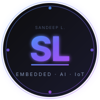
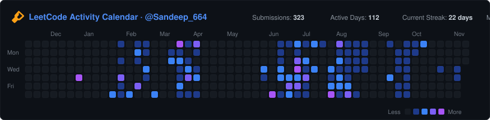

<div align="center">

<!-- ═══════════════════════════════════════════════════════════════════════ -->
<!--                        BRAND IDENTITY & AVATAR                        -->
<!-- ═══════════════════════════════════════════════════════════════════════ -->

<a href="https://github.com/Sandeep-loganathan">
  
</a>

<br/>

<!-- ═══════════════════════════════════════════════════════════════════════ -->
<!--                    ANIMATED TYPING INTRODUCTION                        -->
<!-- ═══════════════════════════════════════════════════════════════════════ -->

[+Dev)](https://git.io/typing-svg)

<br/>

<h1>👋 Hi, I'm <span>Sandeep L</span></h1>

<p align="center">
  <b>Electronics &amp; Communication Engineer | Embedded Systems · IoT · Edge AI · TinyML · VLSI</b><br/>
  <i>Bridging silicon and software — architecting intelligent, low-latency edge systems for the physical world.</i>
</p>

<!-- ═══════════════════════════════════════════════════════════════════════ -->
<!--                        HERO METRIC BADGES                             -->
<!-- ═══════════════════════════════════════════════════════════════════════ -->

<p align="center">
  <a href="https://leetcode.com/u/Sandeep_664/" target="_blank">
    
  </a>
  &nbsp;
  
  &nbsp;
  
</p>

<!-- ═══════════════════════════════════════════════════════════════════════ -->
<!--                         SOCIAL HUB (HEADER)                           -->
<!-- ═══════════════════════════════════════════════════════════════════════ -->

<p align="center">
  <a href="https://github.com/Sandeep-loganathan" target="_blank">
    
  </a>
  &nbsp;
  <a href="https://www.linkedin.com/in/sandy006" target="_blank">
    
  </a>
  &nbsp;
  <a href="https://leetcode.com/u/Sandeep_664/" target="_blank">
    
  </a>
  &nbsp;
  <a href="mailto:kvgsandeep006@gmail.com">
    
  </a>
</p>


</div>

---

<!-- ═══════════════════════════════════════════════════════════════════════ -->
<!--                        BY THE NUMBERS KPI                             -->
<!-- ═══════════════════════════════════════════════════════════════════════ -->

### 📊 By the numbers

| 🏆 Hackathons & Awards | 🧩 DSA & Problem Solving | 📜 Professional Certifications |
| :---: | :---: | :---: |
| 🥇 **1st Prize** — Innovasense<br/>💰 **₹10,000** Cash Award<br/>🌟 **Top 50** CDAC Vegathon 2026<br/>💡 SSN Idea Pitch Participant | 🧠 **200+ Problems** Solved<br/>🎯 Algorithmic Efficiency<br/>⚡ C++, Java, Python<br/>📊 Intuitive Data Structures | 🛡️ **QNX RTOS** Programming<br/>🎓 **3× NPTEL (IIT)** Certified<br/>• Industry 4.0 & IIoT<br/>• Microsensors & Nanosensors |

---

<!-- ═══════════════════════════════════════════════════════════════════════ -->
<!--                            ABOUT ME                                    -->
<!-- ═══════════════════════════════════════════════════════════════════════ -->

## 👨‍💻 About Me

I'm **Sandeep L**, an Electronics and Communication Engineering student passionate about building software solutions and intelligent applications.

- 💻 Interested in **Software Engineering, Data Structures & Algorithms, and Problem Solving**.
- 🤖 Exploring **Artificial Intelligence, Machine Learning, and Computer Vision**.
- 🌐 Developing backend applications, REST APIs, and database-driven solutions.
- ⚙️ Working with **Java, C++, Python, Node.js, Express.js, and MongoDB**.
- 🔌 Exploring Embedded Systems, IoT, and hardware-software integration.
- 🚀 Passionate about learning new technologies and building practical, real-world projects.

**Currently focused on:** Strengthening software development skills, improving problem-solving abilities, and building intelligent applications.

### 🎯 Primary Technical Focus

| Focus Area | Engineering Scope | Key Platforms & Tools |
| :--- | :--- | :--- |
| 💻 **Software Engineering & DSA** | Object-oriented programming, problem-solving, algorithms, data structures and code optimization | Java, C++, Python, Git |
| 🤖 **AI & Machine Learning** | Model development, computer vision, predictive analytics and model optimization | Python, TensorFlow, YOLO, Edge Impulse |
| 🌐 **Backend & Database Development** | REST APIs, server-side development, database design and data management | Node.js, Express.js, Flask, MongoDB |
| ⚙️ **Software Development & Tools** | Application development, debugging, version control, Linux and software integration | Git, GitHub, VS Code, Linux, Google Colab |
| 🔌 **Embedded Software & IoT** | Firmware development, sensor integration, communication protocols and hardware-software integration | Embedded C, ESP32, Arduino, MQTT, LoRa |

---

<!-- ═══════════════════════════════════════════════════════════════════════ -->
<!--                         TECHNICAL SKILLS                               -->
<!-- ═══════════════════════════════════════════════════════════════════════ -->

## 🛠️ Technical Skills

### ⚡ Core Developer Toolchain

<p align="center">
  
</p>

### 💻 Programming Languages
<p>
  
  
  
  
</p>

### 🌐 Backend & Database Development
<p>
  
  
  
  
</p>

### 🔌 Embedded Platforms & Hardware Silicon
<p>
  
  
  
  
</p>

### 🤖 AI, Machine Learning & Computer Vision
<p>
  
  
  
  
</p>

### 🧰 Tools & Development Environments
<p>
  
  
  
  
</p>

### ⚡ Systems, Operating Systems & Paradigms
<p>
  
  
  
  
  
</p>

---

<!-- ═══════════════════════════════════════════════════════════════════════ -->
<!--                  DEVELOPER ANALYTICS & STATS                          -->
<!-- ═══════════════════════════════════════════════════════════════════════ -->

## 📈 Developer Analytics & Problem Solving

<div align="center">

<!-- Side-by-side GitHub Stats and LeetCode Card -->
<a href="https://github.com/Sandeep-loganathan">
  
</a>
&nbsp;
<a href="https://leetcode.com/u/Sandeep_664/" target="_blank">
  
</a>

<br/><br/>

<!-- Top Languages Card -->
<a href="https://github.com/Sandeep-loganathan">
  
</a>

<br/><br/>

<!-- Multi-Panel Profile Summary Breakdown -->
<a href="https://github.com/Sandeep-loganathan">
  
</a>
&nbsp;
<a href="https://github.com/Sandeep-loganathan">
  
</a>
&nbsp;
<a href="https://github.com/Sandeep-loganathan">
  
</a>

</div>

---

<!-- ═══════════════════════════════════════════════════════════════════════ -->
<!--                        LEETCODE ACTIVITY                              -->
<!-- ═══════════════════════════════════════════════════════════════════════ -->

## 📊 LeetCode Activity

<div align="center">

<a href="https://leetcode.com/u/Sandeep_664/" target="_blank">
  
</a>

<p align="center">
  <a href="https://leetcode.com/u/Sandeep_664/" target="_blank">
    
  </a>
</p>

</div>

---

<!-- ═══════════════════════════════════════════════════════════════════════ -->
<!--                   ACHIEVEMENTS & CERTIFICATIONS                        -->
<!-- ═══════════════════════════════════════════════════════════════════════ -->

## 🎖️ Achievements & Certifications

### 🏅 Honors & Competitions

| Honor / Event | Organization / Context | Impact & Distinction |
| :--- | :--- | :--- |
| 🥇 **First Prize Winner** | Innovasense Software Project Competition | Awarded top honors for architectural originality and technical execution |
| 💰 **₹10,000 Cash Prize** | Innovasense Technical Jury | Recognized as the most impactful project solution of the competition |
| 🌟 **Top 50 National Selection** | CDAC Vegathon 2026 | Selected among top 50 engineering teams nationwide for RISC-V edge innovation |
| 💡 **Pitch Participant** | SSN Idea Pitch Competition | Pitched hardware-software innovation for commercial and community impact |

### 🧩 Problem Solving & DSA

<p align="center">
  <a href="https://leetcode.com/u/Sandeep_664/" target="_blank">
    
  </a>
  &nbsp;
  
  &nbsp;
  
</p>

### 📜 Professional Certifications

| Certification Title | Issuing Body | Domain Focus |
| :--- | :--- | :--- |
| 🛡️ **QNX Real-Time Programming Certification** | BlackBerry QNX | Real-Time Operating Systems, IPC & Deterministic Scheduling |
| 🎓 **Blockchain and its Applications** | NPTEL (IIT) | Cryptographic Verification & Distributed Ledger Architectures |
| 🏭 **Introduction to Industry 4.0 & Industrial IoT** | NPTEL (IIT) | Cyber-Physical Systems, Sensor Networks & Smart Automation |
| 🔬 **Microsensors and Nanosensors** | NPTEL (IIT) | MEMS Transducers, Nanoscale Sensing & Solid-State Physics |

---

<!-- ═══════════════════════════════════════════════════════════════════════ -->
<!--                       CONNECT WITH ME                                  -->
<!-- ═══════════════════════════════════════════════════════════════════════ -->

## 🌐 Connect With Me

<div align="center">

<p>
  <a href="https://github.com/Sandeep-loganathan" target="_blank">
    
  </a>
  &nbsp;&nbsp;
  <a href="https://www.linkedin.com/in/sandy006" target="_blank">
    
  </a>
  &nbsp;&nbsp;
  <a href="https://leetcode.com/u/Sandeep_664/" target="_blank">
    
  </a>
  &nbsp;&nbsp;
  <a href="mailto:kvgsandeep006@gmail.com">
    
  </a>
</p>

<br/>

```
📫 Open to collaborations, research discussions, and engineering roles in:
   Embedded Systems Firmware · Industrial IoT · Edge AI / TinyML · RISC-V Architecture
```

</div>

---

<!-- ═══════════════════════════════════════════════════════════════════════ -->
<!--                       CLOSING STATEMENT                                -->
<!-- ═══════════════════════════════════════════════════════════════════════ -->

<div align="center">

<br/>


<br/>

> *"Silicon without intelligence is inert; algorithms without hardware are immaterial.*<br/>
> *Real engineering happens at their junction — in the physical world, on constrained silicon, where reliability is non-negotiable."*

<br/>

<sub>
  Designed with precision by <a href="https://github.com/Sandeep-loganathan">Sandeep L</a> &nbsp;·&nbsp; 
  Electronics &amp; Communication Engineering &nbsp;·&nbsp;
  Last updated: November 2026
</sub>

</div>
